<p align="center">
  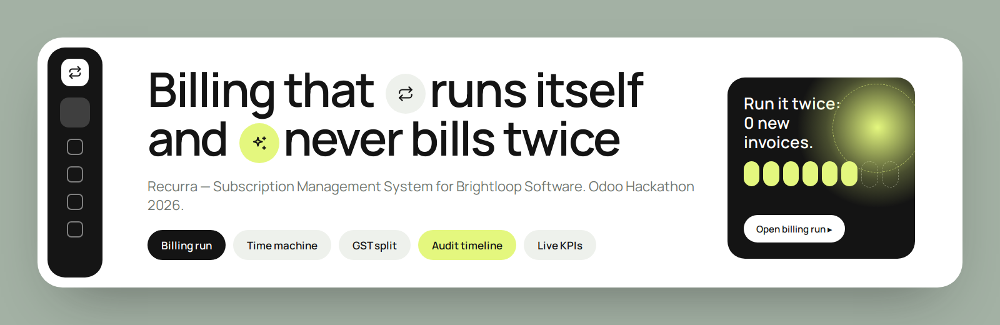
</p>

<h1 align="center">Recurra</h1>
<p align="center"><strong>Subscription Management System for Brightloop Software</strong><br>Odoo Hackathon 2026 · Team of four · Built in one day</p>

<p align="center">
  
  
  
  
  
</p>

> Brightloop doesn't need a better spreadsheet. It needs billing that runs itself.
> Recurra bills on schedule, can never bill twice, applies taxes and discounts on its own,
> and shows finance the real numbers on one screen.

<p align="center">
  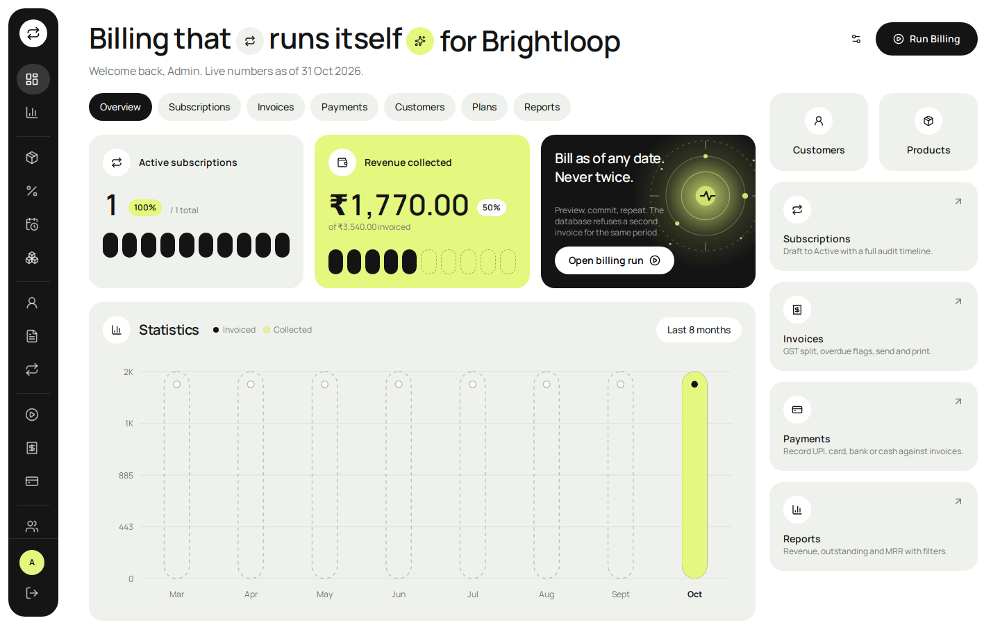
</p>

## Table of contents
- [The problem](#the-problem)
- [What makes Recurra different](#what-makes-recurra-different)
- [Features](#features)
- [Roles](#roles)
- [Quick start](#quick-start)
- [Demo accounts](#demo-accounts)
- [Three-minute demo](#three-minute-demo)
- [Screenshots](#screenshots)
- [Architecture](#architecture)
- [Team](#team)

## The problem
Brightloop sells recurring software plans but tracks customers, renewals, invoices and payments by hand.
Invoices get missed or raised twice, GST is split wrongly across states, and nobody knows the real MRR
or how much money is overdue.

## What makes Recurra different
| | |
|---|---|
| **Billing run with a time machine** | Pick any "bill as of" date, preview the dry run, then commit. Jump two months ahead to see what will be invoiced and what turns overdue. |
| **Double billing is impossible** | A database unique constraint on `(subscription, period start)` backs the engine. Run billing twice: the second run creates 0 invoices and lists every subscription as "already billed". |
| **GST that knows geography** | Kerala customers get CGST + SGST split in half; every other state gets IGST. Computed on the discounted amount, per line. |
| **Audit timeline** | Every create, edit and status change on a subscription is logged and shown as a vertical timeline. |
| **Live finance dashboard** | Active subscriptions, MRR, revenue collected, outstanding and overdue, straight from the database with Prisma aggregates. No static numbers anywhere. |

## Features
| Area | What you can do |
|------|-----------------|
| **Authentication** | Sign up (live password checklist: length, upper, lower, special character), log in, reset password with a 30-minute token. Public signups become portal customers. |
| **Users & customers** | Admin creates internal staff. Staff manage customers with GSTIN format validation. |
| **Catalog** | Taxes (0 to 100 %), products with variants and extra prices, recurring plans (daily / weekly / monthly / yearly, pausable, closable, auto-close), discounts (fixed or percent, validity window, usage limit, admin only). |
| **Sales** | Quotation templates, subscriptions with lines, variant-aware pricing, auto numbers SUB-0001. Status machine Draft → Quotation → Confirmed → Active → Closed, with Pause only when the plan allows. |
| **Billing** | Billing run (dry run / commit), invoices with discount and GST split, overdue flags, confirm / cancel / send / print, payments by UPI, card, bank or cash, automatic PAID state. |
| **Portal** | Customers see only their own subscriptions and invoices, accept quotations, pause or close when allowed. |
| **Reports** | Revenue, invoiced, outstanding, overdue, MRR by plan and subscriptions by status, filtered by date range, plan and status. |

## Roles
| Role | Can do |
|------|--------|
| **ADMIN** | Everything, including users, discounts and committing billing runs |
| **INTERNAL** | Day-to-day operations: catalog, customers, subscriptions, billing preview, invoices, payments |
| **PORTAL** | Customer: sees and acts only on their own data |

Role checks run on the server in every page and Server Action. Typing `/users` as staff redirects away.

## Quick start
Requires Node 20+ and Git. No cloud services, no API keys: the database is a local SQLite file.

```bash
git clone https://github.com/Nikhil-k00/Odoo-hackathon.git
cd Odoo-hackathon
npm install
cp .env.example .env
npx prisma migrate dev      # creates prisma/dev.db and seeds demo data
npm run dev                 # http://localhost:3000
```

| Script | Purpose |
|--------|---------|
| `npm run dev` | Development server |
| `npm run build && npm start` | Production build |
| `npm run typecheck` / `npm run lint` | TypeScript and ESLint, both clean on `main` |
| `npm run test:e2e` | Browser end-to-end run of the full demo flow (needs the app on port 3177, see `tests/README.md`) |
| `npx prisma db seed` | Re-run the seed (safe to repeat) |
| `npm run db:reset` | Wipe the local database and re-seed |

## Demo accounts
| Role | Email | Password |
|------|-------|----------|
| ADMIN | `admin@recurra.in` | `Admin@1234` |
| INTERNAL | `staff@recurra.in` | `Staff@1234` |
| PORTAL (Kerala) | `customer1@demo.in` | `Customer@1234` |
| PORTAL (Kerala) | `customer2@demo.in` | `Customer@1234` |
| PORTAL (Karnataka) | `customer3@demo.in` | `Customer@1234` |

The seed also creates GST 18 %, two products (one with a **Brand = Odoo** variant at +₹560),
Monthly and Yearly plans, and an active 10 % discount `LAUNCH10`.

## Three-minute demo
1. **Visitor** signs up with a weak password (checklist turns red), then a strong one, and lands in the portal.
2. **Admin** creates GST 18 %, a product with the Odoo variant, a monthly plan and a 10 % discount.
3. **Admin** creates an internal user; that user cannot open Users or Discounts.
4. **Staff** creates a subscription from a template and walks it Draft → Quotation → Confirmed → Active. The timeline records each step.
5. **Admin** runs billing: preview, run, run again. The second run creates 0 invoices.
6. **Staff** opens the invoice: discount, CGST + SGST, print, record a payment, status becomes PAID.
7. **Admin** sets "bill as of" two months ahead: new invoices appear and one shows as overdue.
8. **Customer** opens the portal and sees only their own data; pauses if the plan allows.
9. **Admin** opens Dashboard and Reports: active subscriptions, MRR, revenue, outstanding, overdue, with filters.

Tips for the demo:
- Start the main subscription **today** so the second billing run shows 0 new invoices.
- To show an **overdue** invoice, create one extra subscription with a start date a month or two in the past and run billing: its first invoice was due a week after that past start, so it shows the Overdue badge immediately.
- Attach a discount on the subscription form if you want the invoice to show the discount line.

## Screenshots
**Billing run** — time machine date, dry-run preview, commit (admin only)
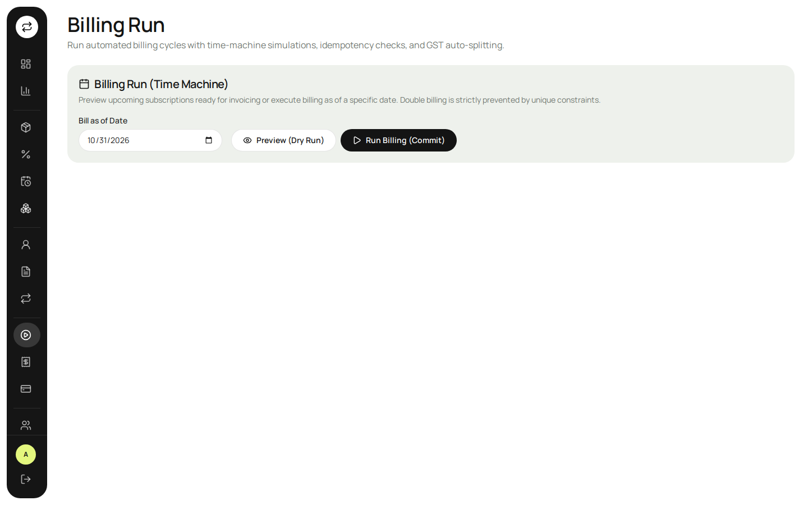

**Invoices** — status filters, overdue flag, GST split and outstanding per invoice
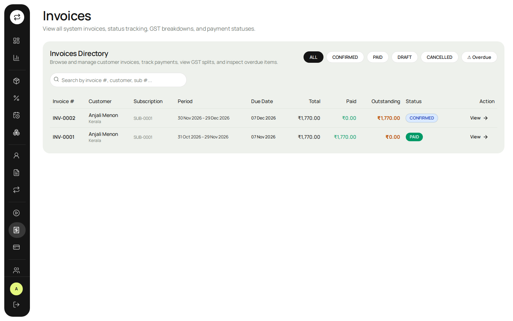

**Subscription detail** — lines, plan flags, audit timeline and generated invoices
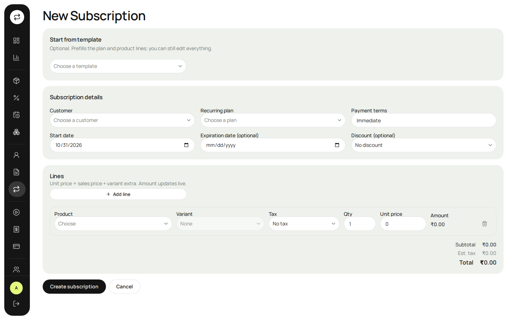

**New subscription** — start from template, variant-aware unit prices, live totals
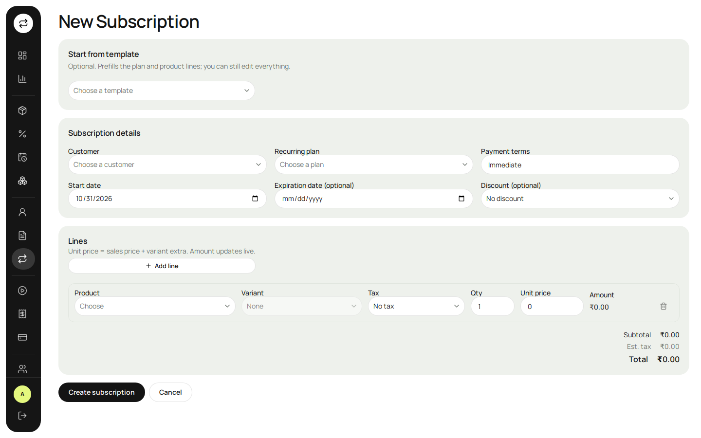

**Invoice detail** — customer, lines, discount, CGST + SGST, record payment
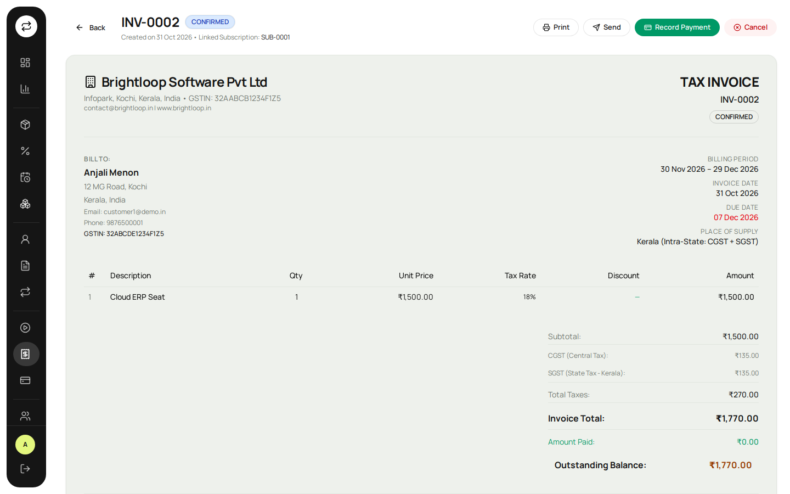

**Reports** — filters by date, plan and status; MRR by plan; overdue and payments tables
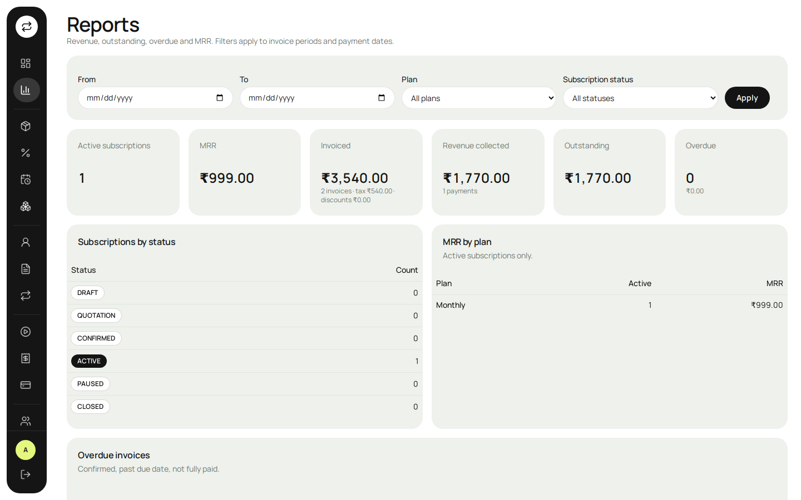

| Subscriptions | Products |
|---|---|
| 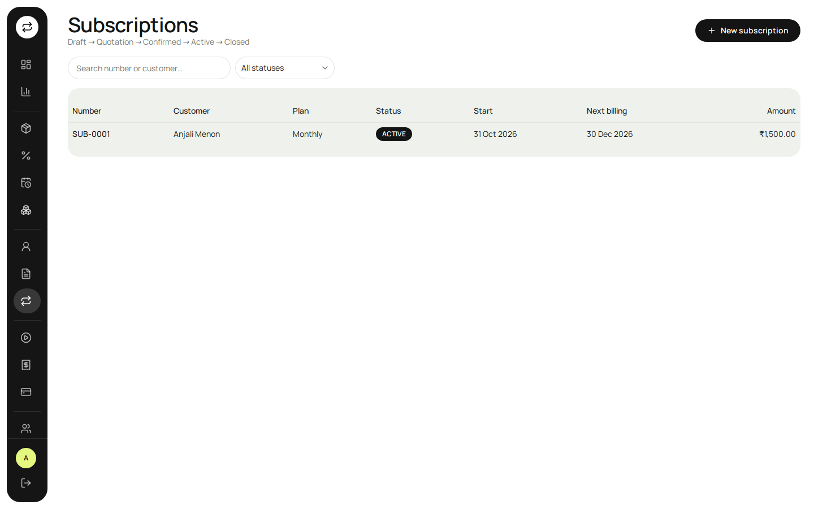 | 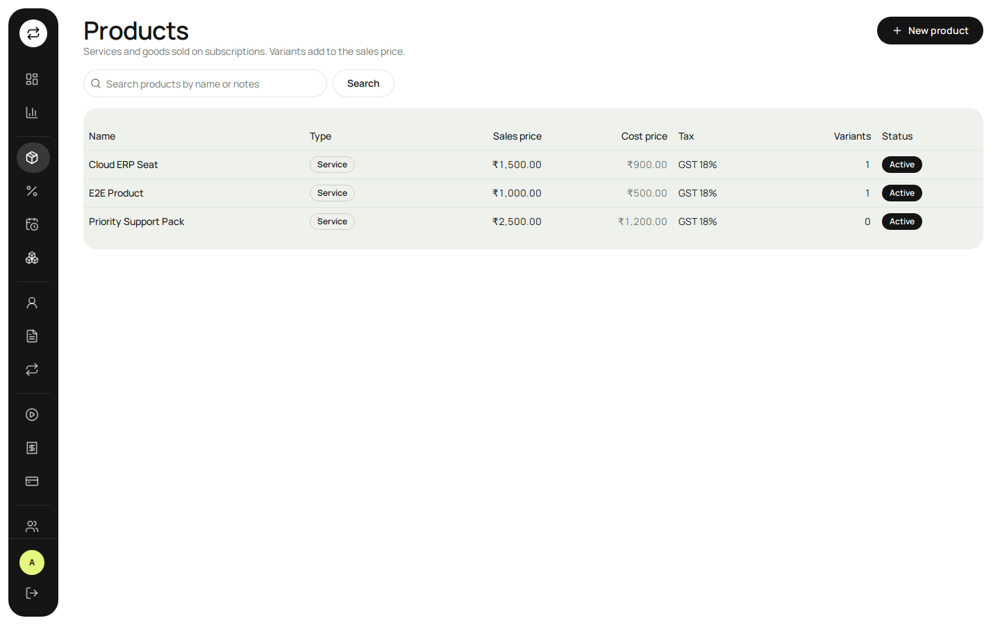 |

| Customers | Customer portal |
|---|---|
| 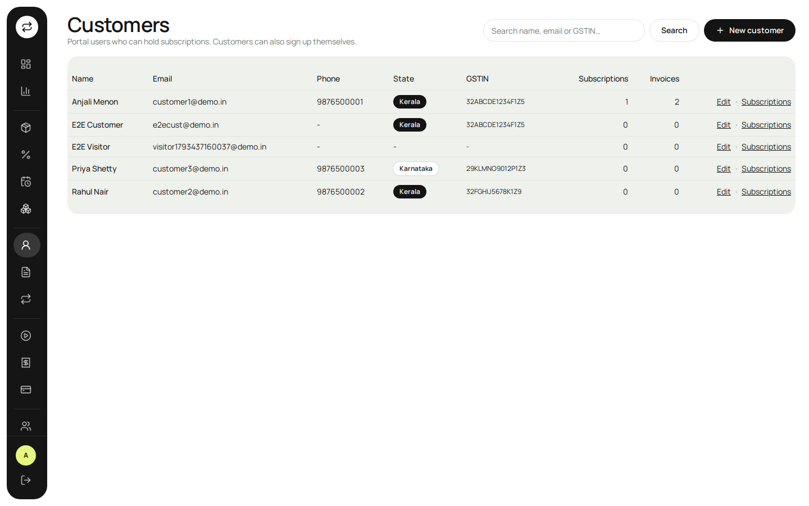 | 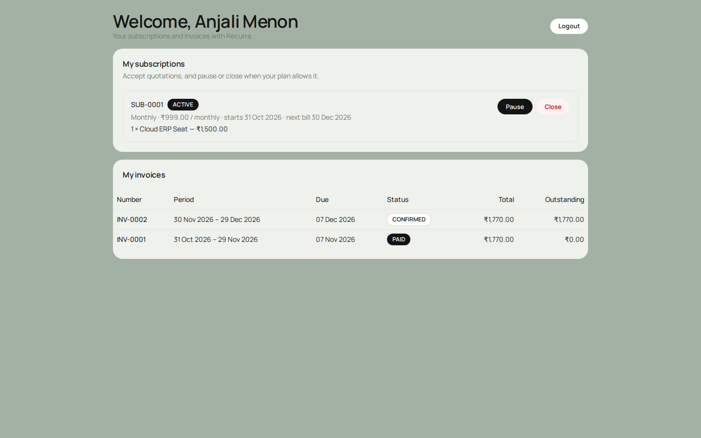 |

| Login | Signup with live password checklist |
|---|---|
| 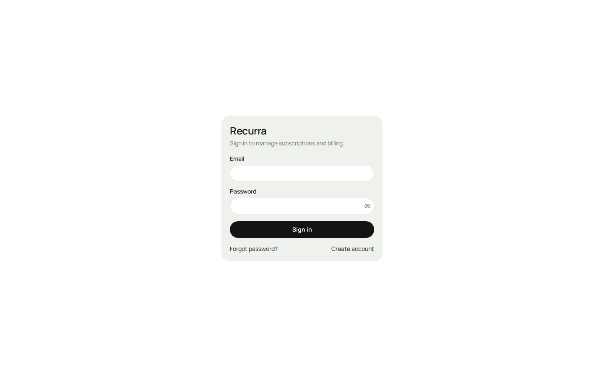 | 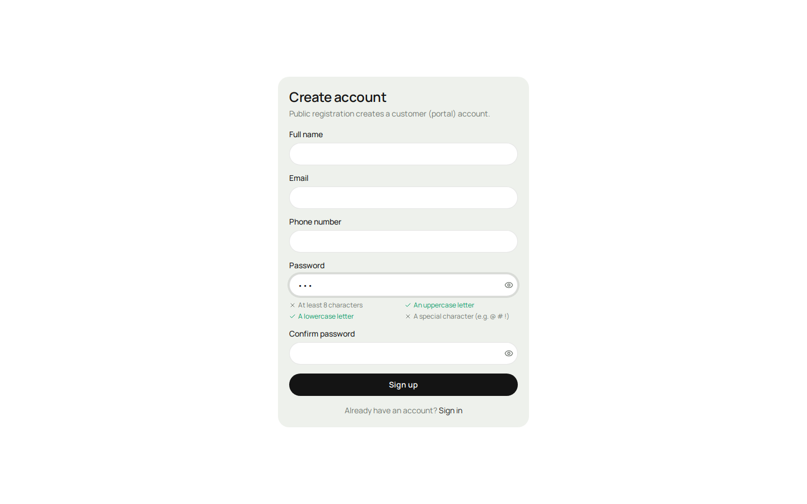 |

The visual system follows `docs/design-reference.webp`: full-screen white surface, dark icon rail that
expands on hover, black pill buttons, lime accent and Manrope type (self-hosted, so it works offline).

## Architecture
Next.js App Router with Server Actions. Every form validates with Zod on the server and shows inline
errors. All data lives in SQLite through Prisma; there is no static or mocked data.

```
prisma/                  schema + migration + seed
src/app/(auth)/          login, signup, forgot-password, reset-password
src/app/(app)/           authenticated app: dashboard, reports, catalog, sales, billing, admin
src/app/portal/          customer portal
src/features/
  auth/                  login, signup, reset, users, customers
  catalog/               taxes, products, variants, plans, discounts
  subscriptions/         templates, subscriptions, status machine, audit log
  billing/               engine.ts (dry run / commit, GST, discounts), invoices, payments
src/components/          app-sidebar, page-header, dashboard tiles and chart, shadcn ui/*
src/lib/                 db (Prisma), session (JWT cookie), money, dates
src/middleware.ts        redirects to /login without a session cookie
```

Key invariants:
- `Invoice @@unique([subscriptionId, periodStart])` makes the billing run idempotent.
- `features/subscriptions/status.ts` is the only place transitions are defined; the UI renders only what it allows and the Server Action re-checks.
- `features/billing/engine.ts` is pure, commented and wrapped in `prisma.$transaction` per subscription.

## Team
| Member | GitHub | Owned |
|--------|--------|-------|
| Sanika K | [@saniluttu](https://github.com/saniluttu) | Foundation, schema, shared libs, design system, integration; Sales lane (templates, subscriptions, status machine, portal) |
| Nikhil K | [@Nikhil-k00](https://github.com/Nikhil-k00) | Authentication, users, dashboard and reports |
| Irine Rose Saji | [@irinerosesajis-dot](https://github.com/irinerosesajis-dot) | Catalog: taxes, products, variants, plans, discounts |
| Muhammed Luthufi | [@luthfi-tp](https://github.com/luthfi-tp) | Billing engine, invoices, payments, print |

Each lane was built on its own branch and merged through its own pull request.
Team conventions live in `CLAUDE.md`; the original build plan is `Recurra_Team_Build_Guide.pdf`.
